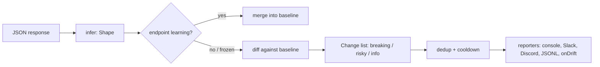

# api-drift

> Know when the APIs you depend on change, before your users do.

Third-party APIs change their response shape without notice. A field disappears, a number
becomes a string, `null` starts showing up, a new enum value falls through your `switch`.
Your app finds out in production.

Contract-testing tools assume you own both sides (Pact) or that the provider publishes an
accurate spec (OpenAPI diffing). **api-drift works from the consumer side with nothing but
observed traffic.** It learns the contract of every endpoint you call, then tells you, with
a severity and a readable sentence, when a response stops matching it.

```text
$ npx api-drift check
api-drift check · 3 endpoints · baseline .api-drift/baseline.json

✖ GET api.github.com /repos/nodejs/node 2xx  2 breaking · 1 risky · 1 info  200 · 545 ms
    ✖ breaking  $.license.html_url   field is missing (was present in the baseline sample)
    ✖ breaking  $.open_issues_count  type changed from string<numeric-string> to integer
    ▲ risky     $.mirror_url         can now be null (was string<uri>)
    ● info      $.allow_forking      new field (boolean)
✔ GET registry.npmjs.org /react/latest 2xx   no drift  200 · 138 ms
✔ GET api.open-meteo.com /v1/forecast 2xx    no drift  200 · 578 ms

2 breaking · 1 risky · 1 info   FAIL (--fail-on breaking)
```

- **Zero runtime dependencies.** TypeScript, ESM + CJS + `.d.ts`. Node ≥ 18, browsers, Deno, Bun,
  Cloudflare Workers and Vercel Edge.
- **Small.** `api-drift` is 11.7 KB and `api-drift/core` 11.2 KB, minified and gzipped.
- **Zero added latency.** The fetch wrapper returns the original `Response`; inspection runs on a
  `clone()` in the background, and internal errors never reach your code.
- **Private by design.** Shapes are stored, values are not. Query strings, id-like path segments
  and dictionary keys never reach the baseline.
- **CLI + GitHub Action.** Snapshot, check, import a browser HAR, diff, generate TypeScript or Zod.

## Contents

- [30-second quick start](#30-second-quick-start)
- [Runtime instrumentation](#runtime-instrumentation)
- [How it works](#how-it-works)
- [What counts as drift](#what-counts-as-drift)
- [Got no spec? Generate one from real traffic](#got-no-spec-generate-one-from-real-traffic)
- [CLI reference](#cli-reference)
- [GitHub Action](#github-action)
- [API reference](#api-reference)
- [FAQ](#faq)
- [Comparison](#comparison)
- [Roadmap](#roadmap)

## 30-second quick start

> **Pre-release.** Until the first npm release, install straight from GitHub:
> `npm i -D github:rutvirupani1111/api-drift` (it builds itself on install), then use
> `npx api-drift` as below.

```bash
npx api-drift init https://api.github.com/repos/nodejs/node https://registry.npmjs.org/react/latest
npx api-drift snapshot     # record the contract into .api-drift/baseline.json (commit it)
npx api-drift check        # later, or in CI: compare live responses against it
```

```text
$ npx api-drift snapshot
api-drift snapshot · 3 endpoints

✔ GET api.github.com /repos/nodejs/node 2xx  200 · 534 ms · 129 fields
✔ GET registry.npmjs.org /react/latest 2xx   200 · 85 ms · 60 fields
✔ GET api.open-meteo.com /v1/forecast 2xx    200 · 600 ms · 23 fields

Baseline written to .api-drift/baseline.json (3 endpoints)
```

Already have traffic? Record a session in your browser (DevTools, Network tab, *Export HAR*) and
turn it into a contract in one command:

```text
$ npx api-drift import-har session.har
api-drift import-har · session.har

✔ 7 JSON responses learned from 12 entries (5 skipped: 2 not-json, 1 no-body, 1 invalid-json, 1 no-response)

  GET api.shop.test /api/orders 2xx     2 responses · 9 fields
  GET api.shop.test /api/users/:id 2xx  3 responses · 7 fields
  GET api.shop.test /api/users/:id 4xx  1 response · 2 fields
  POST api.shop.test /api/cart 2xx      1 response · 3 fields

Baseline written to .api-drift/baseline.json (4 endpoints)
```

See what was learned, or turn it into types:

```text
$ npx api-drift explain "users/:id 2xx"
GET api.shop.test /api/users/:id 2xx
3 samples · learning · first seen 2026-10-22 10:00Z · last seen 2026-10-22 10:00Z
https://api.shop.test/api/users/1

$              object
├─ avatar_url  string<uri> | null
├─ created_at  string<date-time>
├─ email       string<email>
├─ id          integer
├─ name        string
├─ nickname?   string  optional 1/3
└─ role        string

$ npx api-drift types --out src/api-types.ts          # TypeScript interfaces
$ npx api-drift types --zod --out src/api-schemas.ts  # Zod schemas (no zod needed to generate)
```

## Runtime instrumentation

Watch real production traffic instead of (or as well as) scheduled checks:

```ts
import { createDrift, consoleReporter } from 'api-drift';
import { fileStore } from 'api-drift/node';

const drift = createDrift({
  store: fileStore('.api-drift/baseline.json'),
  mode: 'auto', // learn each endpoint for 20 samples or 1 hour, then freeze and watch
  include: ['api.stripe.com', /\.githubusercontent\.com$/],
  sampleRate: 0.2,
  reporters: [consoleReporter()],
  onDrift: (e) => console.warn(e.summary),
});

export const fetch = drift.wrapFetch(globalThis.fetch); // or drift.patchGlobalFetch()
```

- The wrapped fetch returns **the original `Response`, untouched**. Inspection runs on a `clone()`
  after a macrotask, bounded in size, and any internal error goes to `onError`, never to you.
- Only JSON responses (`content-type` contains `json`) are inspected.
- `drift.check(key, payload)` covers everything that is not fetch: queues, websockets, SDK results.
- `api-drift/axios` adds a duck-typed interceptor: `attachAxios(drift, axiosInstance)`.
- On serverless and edge runtimes, seed a `memoryStore` from the committed baseline, use
  `mode: 'watch'`, and hand `drift.flush()` to `waitUntil`. See [`examples/`](examples).

Every drift event is deduplicated per endpoint and change, with a cooldown (default one hour), so
a broken field produces one Slack message, not one per request.

## How it works



1. **Infer.** Every value becomes a `Shape`: kinds (`null`, `boolean`, `integer`, `number`,
   `string`, `array`, `object`, `union`), string formats (date-time, date, time, email, uri, uuid,
   ipv4, ipv6, hex color, semver, base64, jwt, phone, numeric string, empty), array length bounds,
   and **observation counts**. Code-like strings with low cardinality become enums once there is
   enough evidence (20 observations, at most 12 values by default).
2. **Merge.** Shapes from many responses merge into one. Counts tell the merged shape which fields
   are always present (required) and which only sometimes (optional). `merge` is commutative,
   associative and idempotent on structure, which is property-tested.
3. **Key.** Responses are grouped by `METHOD host /templated/path status-class`, where id-like
   segments (integers, UUIDs, ObjectIds, hex, slugs with digits, emails, dates) become `:id`:
   `GET api.github.com /repos/:id/pulls/:id 2xx`.
4. **Diff.** A new response is compared with the learned contract. Only evidence the baseline did
   not allow is reported, so a response that was part of learning can never be flagged as breaking.
5. **Report.** Changes carry a JSONPath-like `path`, a `kind`, a `severity`, human `before` /
   `after` descriptions and a one-line `message`.

The baseline is plain, sorted, diff-friendly JSON. Commit it; review changes to it like code.
[docs/ARCHITECTURE.md](docs/ARCHITECTURE.md) goes deeper.

## What counts as drift

| Severity | Kind | Example message |
| --- | --- | --- |
| breaking | `removed` | field is missing (was present in all 20 baseline samples) |
| breaking | `type-changed` | type changed from string to integer · was an array, now an object |
| breaking | `status-changed` | status changed from 2xx to 5xx |
| risky | `nullable` | can now be null (was string&lt;uri&gt;) |
| risky | `optional` | sometimes missing: absent in 2 of 5 samples (was always present) |
| risky | `enum-added` | new enum value "archived" (known: "active", "paused") |
| risky | `format-changed` | format changed from date-time to string |
| risky | `number-narrowed` | now an integer (baseline saw only decimals in 40 values) |
| risky | `number-widened` | decimals appeared (baseline saw only integers in 40 values) |
| risky | `emptied` | now empty (baseline always had at least 1 item) |
| info | `added` / `added-optional` | new field (boolean) · new optional field (string, in 1 of 3 samples) |
| info | `enum-removed` | enum value "pending" no longer observed |
| info | `format-gained` | values now look like date-time |
| info | `type-learned` | now string (baseline only saw null) |
| info | `negative` | negative values appeared (none in 40 baseline values) |

Integer/decimal and sign changes need 10 baseline observations before they are reported
(`minSamples`), so a temperature that happens to be `28.0` does not look like a type change.
Any kind can be re-graded or silenced, and any path ignored:

```jsonc
"diff": {
  "ignore": ["$.meta", "$.data[].debug_*", "$.current_weather.is_day"],
  "severity": { "added": "ignore", "enum-added": "breaking" }
}
```

## Got no spec? Generate one from real traffic

Most APIs you depend on publish no OpenAPI document, or one that stopped matching reality long
ago. api-drift already knows the contract each endpoint actually honours, so it can write the
spec for you:

```console
$ npx api-drift import-har session.har            # or: npx api-drift snapshot
$ npx api-drift openapi --out openapi.json
✔ Wrote OpenAPI 3.1 (JSON): 3 paths, 4 operations to openapi.json
$ npx api-drift openapi --out openapi.yaml --title "Shop API"   # .yaml/.yml implies --yaml
```

| Learned | OpenAPI 3.1 |
| --- | --- |
| `GET api.shop.test /api/users/:id 2xx` | `paths["/api/users/{userId}"].get`, path parameter `userId` (named after the collection) |
| status class `4xx` | `responses["4XX"]` |
| kept query keys (`--keep-query type`) | query parameters; fixed values become an `enum`, `required` when every key had it |
| hosts | `servers`, per path item when several hosts are present (`https`, unless the recorded example was `http`) |
| the shape | JSON Schema 2020-12 under `components.schemas`, named like `api-drift types` (`GetApiUsersByIdResponse`) |
| present in every sample | `required` |
| `string<uri> \| null` | `type: [string, "null"]`, `format: uri` |
| enum candidates (20+ samples) | `enum` (including `null` when nullable) |
| id-keyed dictionaries (`{"1001": {...}}`) | `additionalProperties` |
| mixed types | a type array, or `anyOf` when the variants carry their own keywords |

```yaml
paths:
  "/api/users/{userId}":
    get:
      operationId: getApiUsersById
      responses:
        "2XX":
          content:
            application/json:
              schema:
                $ref: "#/components/schemas/GetApiUsersByIdResponse"
          description: Observed 2xx response
        "4XX":
          # ...
    parameters:
      - in: path
        name: userId
        required: true
        schema:
          type: string
components:
  schemas:
    GetApiUsersByIdResponse:
      properties:
        avatar_url:
          format: uri
          type:
            - string
            - "null"
        created_at:
          format: date-time
          type: string
        nickname:
          type: string
        # ...
      required:
        - avatar_url
        - created_at
        # ...
      type: object
```

- **No example values.** No `example`/`examples`, no URLs beyond the host, no ids, timestamps or
  sample counts. Enum values are the same code-like values `api-drift types` emits.
- **Diffs cleanly.** Keys are sorted (the top level keeps `openapi`, `info`, `servers`, `paths`,
  `components`), so the same baseline always produces the same bytes. Commit `openapi.json` next
  to the baseline and `git diff` shows only contract changes.
- **Honest about what it is.** It describes what was observed: `required` means "present in every
  sample", `additionalProperties` is never `false`, and formats JSON Schema does not define
  (semver, jwt, phone, ...) are kept as an `x-api-drift-format` annotation (`base64` becomes
  `contentEncoding`).
- The same route on several hosts (production and staging) is one operation that lists both
  servers; its schema is the merge of what each host returned. Custom keys that are not
  `METHOD host /path` keys are skipped with a warning.
- YAML comes from a small built-in emitter: no dependency.

From code (browser-safe, `api-drift/core`):

```ts
import { toOpenApi, openApiToJson, toYaml } from 'api-drift/core';

const doc = toOpenApi(baseline, { title: 'Shop API', version: '2.0.0' });
await writeFile('openapi.yaml', toYaml(doc)); // or openApiToJson(doc)
```

## CLI reference

```text
api-drift <command> [options]

init [url...]           Create api-drift.config.json with commented examples
snapshot                Call every endpoint and record the baseline
check                   Call endpoints again and report drift against the baseline
import-har <file.har>   Build a baseline from a browser HAR export
diff <a> <b>            Diff two baselines or two JSON payloads
types                   Generate TypeScript interfaces or Zod schemas
openapi                 Export the learned contracts as an OpenAPI 3.1 spec
explain [endpoint]      Print an inferred contract as a tree
```

Exit codes: `0` no drift at or above `--fail-on`, `1` drift found, `2` usage, config, baseline or
network error. Colours follow the terminal (`NO_COLOR`, `FORCE_COLOR`, `--no-color` are honoured;
GitHub Actions logs are coloured). Every command has `--help`.

| Command | Options |
| --- | --- |
| `init [url...]` | `-c, --config <file>` · `--force` |
| `snapshot` | `-c, --config` · `-b, --baseline` · `-n, --samples <n>` · `--only <name>` (repeatable) · `--merge` · `-f, --format pretty\|json` · `-q, --quiet` |
| `check` | `-c, --config` · `-b, --baseline` · `-f, --format pretty\|json\|markdown` · `--fail-on breaking\|risky\|info\|never` · `-n, --samples` · `--only` · `--update` (accept drift into the baseline) · `--json-file <file>` · `-q, --quiet` |
| `import-har <file>` | `-o, --out <file>` · `--merge` · `--include <pattern>` · `--exclude <pattern>` (hosts, `host/path` prefixes or `/regex/`) · `--keep-query a,b` · `-f, --format pretty\|json` |
| `diff <a> <b>` | `-f, --format pretty\|json\|markdown` · `--fail-on` (default `breaking`) · `-e, --endpoint <key>` (when one side is a baseline and the other a payload) |
| `types` | `-b, --baseline` · `-o, --out <file>` · `--zod` · `-e, --endpoint <text>` (repeatable) |
| `openapi` | `-b, --baseline` · `-o, --out <file>` (`.yaml`/`.yml` implies `--yaml`) · `--yaml` · `--title <text>` · `--api-version <v>` · `-e, --endpoint <text>` (repeatable) |
| `explain [endpoint]` | `-b, --baseline` · `-f, --format pretty\|json` · `--depth <n>`. Any unique part of the key or example URL selects an endpoint. |

### Config file

`api-drift init` writes `api-drift.config.json`. It is JSON with comments (like `tsconfig.json`),
and ships with a JSON schema for editor completion.

```jsonc
{
  "$schema": "./node_modules/api-drift/schema/config.schema.json",
  "baseline": ".api-drift/baseline.json",        // relative to this file
  "defaults": { "timeout": 10000, "samples": 1, "headers": { "accept": "application/json" } },
  "endpoints": [
    { "name": "npm: react", "url": "https://registry.npmjs.org/react/latest" },
    {
      "name": "GitHub repo",
      "url": "https://api.github.com/repos/nodejs/node",
      "headers": { "authorization": "${GITHUB_AUTH:-}" }   // empty header = not sent
    },
    { "method": "POST", "url": "https://httpbin.org/anything", "body": { "q": "test" }, "samples": 3 }
  ],
  "failOn": "breaking",
  "concurrency": 4,
  "maxPayloadBytes": 1000000,
  "infer": { "enumMaxValues": 12, "ranges": false },
  "diff": { "ignore": [], "severity": {}, "enumMinSamples": 20, "minSamples": 10 }
}
```

- `${ENV_VAR}` and `${ENV_VAR:-default}` are substituted in URLs, headers and bodies. A missing
  variable without a default is an error naming the variable.
- **Secrets never leak:** reports show the URL as written in the config, and every substituted
  value (6+ characters) is masked as `***` in keys and error messages.
- `samples` calls each endpoint several times per run; more samples mean better
  required/optional detection. Samples that disagree on the status class are an error.
- A `5xx` (or `4xx`) where the baseline has a `2xx` is a breaking `status-changed`.
- An endpoint missing from the baseline is reported as *new* and never fails the run.

### Reports

`--format markdown` is written for `$GITHUB_STEP_SUMMARY` and pull-request comments:

```markdown
## API drift report: ✖ Failed

**2 breaking** · **1 risky** · 1 info · 1 endpoint checked

| | Endpoint | Result |
| --- | --- | --- |
| ✖ | `GET api.github.com /repos/nodejs/node 2xx` | 2 breaking, 1 risky, 1 info |

### ✖ `GET api.github.com /repos/nodejs/node 2xx`

| Severity | Path | Change |
| --- | --- | --- |
| ✖ **breaking** | `$.license.html_url` | field is missing (was present in the baseline sample) |
| ✖ **breaking** | `$.open_issues_count` | type changed from string&lt;numeric-string&gt; to integer |
| ▲ **risky** | `$.mirror_url` | can now be null (was string&lt;uri&gt;) |
| ● info | `$.allow_forking` | new field (boolean) |
```

`--format json` prints a stable, versioned `DriftReport` (`version`, `ok`, `failed`, `summary`,
`endpoints[].changes[]`), the same object `runCheck` returns.

## GitHub Action

`action.yml` at the repository root is a composite action: it runs
`api-drift check --format markdown`, appends the report to the job summary, exposes the counts
as outputs and fails the step on breaking changes.

```yaml
- uses: actions/checkout@v4
- uses: actions/setup-node@v4
  with: { node-version: 22 }
- uses: rutvirupani1111/api-drift@v0     # the repository hosting this action, or ./ inside it
  id: drift
  with:
    config: api-drift.config.json
    fail-on: breaking            # breaking | risky | info | never
  env:
    GITHUB_AUTH: Bearer ${{ secrets.GITHUB_TOKEN }}
```

Inputs: `config`, `baseline`, `fail-on`, `only`, `samples`, `working-directory`, `version`.
Outputs: `exit-code`, `breaking`, `risky`, `info`, `report` (path of the JSON report). The action
runs the `dist/cli.js` that ships in the action checkout when present, otherwise
`npx api-drift@<version>`. A full scheduled + pull-request workflow is in
[`examples/github-action.yml`](examples/github-action.yml).

## API reference

### Entry points

| Import | Runs on | What |
| --- | --- | --- |
| `api-drift` | everywhere | `createDrift`, stores, reporters + the engine (`infer`, `merge`, `diff`, keys, baselines) |
| `api-drift/core` | everywhere | the full engine: everything above minus the runtime, plus `generateTypes` and `importHar` |
| `api-drift/report` | everywhere | `renderText`, `renderMarkdown`, `renderJson`, `buildReport`, `renderShapeTree`, `explainEntry`, `createStyle` |
| `api-drift/axios` | everywhere | `attachAxios(drift, axiosInstance)` |
| `api-drift/node` | Node | `fileStore`, `jsonlReporter`, `loadConfig`, `runSnapshot`, `runCheck`, `runCli`, `readBaseline`, `writeBaseline` |

All entry points are tree-shakeable (`sideEffects: false`) and fully typed.

### `createDrift(options)`

| Option | Default | |
| --- | --- | --- |
| `store` | `memoryStore()` | Where contracts live: `memoryStore`, `fileStore`, `localStorageStore`, or any `{ get, set, list }` (sync or async). |
| `mode` | `'auto'` | `learn` merges every sample and never reports. `watch` compares against a frozen baseline. `auto` learns each endpoint, then freezes it. |
| `freezeAfter` | `{ samples: 20, duration: '1h' }` | Auto mode: freeze an endpoint after N samples or T time, whichever comes first. |
| `include` / `exclude` | all | Host strings (`'api.stripe.com'` covers subdomains, `'*.x.com'` only subdomains), `host/path` prefixes, RegExps (tested on the host, then the full URL) or `(url, method) => boolean`. |
| `sampleRate` | `1` | Fraction of responses inspected. |
| `keyFor` | built-in | `(request) => string \| null`; `null` skips the request. |
| `keepQuery` | `[]` | Query parameters that distinguish endpoints. |
| `infer` | | Inference options (below). |
| `diff` | | `{ ignore, severity, enumMinSamples, minSamples }`. |
| `minSeverity` | `'info'` | Lower-severity changes are not reported (they are still in `check()` results). |
| `cooldown` | `'1h'` | The same change on the same endpoint is reported once per cooldown. `0` disables dedup. |
| `maxPayloadBytes` | `1_000_000` | Larger responses are skipped (by `content-length`, or while streaming). |
| `reporters` | `[]` | Functions receiving every `DriftEvent`. |
| `onDrift` | | Shorthand for one reporter. |
| `onError` | one `console.warn` | Internal failures. Never thrown into your request path. |
| `onWarning` | ignored | Skipped payloads (`too-large`, `invalid-json`) and trimmed shapes. |
| `now`, `random` | `Date.now`, `Math.random` | Injectable for tests. |

The returned `Drift`:

```ts
interface Drift {
  wrapFetch<F extends typeof fetch>(fetch: F): F; // returns the original Response objects
  patchGlobalFetch(): () => void;                  // returns an undo function
  check(key: string | { method?: string; url: string; status?: number }, payload: unknown): Promise<CheckResult>;
  observe(response: { method?: string; url: string; status: number; contentType?: string | null; body: unknown }): void;
  flush(): Promise<void>;                          // wait for background work, flush the store
  baseline(): Promise<Baseline>;                   // export the store
  readonly mode: Mode;
  readonly store: DriftStore;
}

interface DriftEvent {
  key: string;                                     // GET api.example.com /users/:id 2xx
  severity: 'breaking' | 'risky' | 'info';         // the highest in `changes`
  changes: Change[];
  counts: { breaking: number; risky: number; info: number };
  summary: string;                                 // one line, ready to log
  timestamp: string;
  request?: { method: string; url: string; status?: number }; // URL without query string
}
```

### Stores and reporters

```ts
memoryStore(initial?: Baseline)                   // seed from a committed baseline
localStorageStore(prefix = 'api-drift:', { storage? })
fileStore(path, { debounce = 250 })               // api-drift/node: debounced atomic writes, flushed on exit
consoleReporter({ color?, unicode?, minSeverity?, log? })
webhookReporter(url, { format: 'slack' | 'discord' | 'json', minSeverity?, headers?, timeout?, fetch? })
jsonlReporter(path)                               // api-drift/node
```

`webhookReporter` posts with the un-instrumented fetch, so reporting never feeds back into drift.

### Engine (`api-drift/core`)

```ts
infer(value, options?): Shape
merge(a: Shape, b: Shape, { enumMaxValues }?): Shape
mergeAll(shapes): Shape | undefined
diff(baseline: Shape, current: Shape, options?): Change[]
describe(shape): string                            // "string<date-time> | null"
endpointKey({ method, url, status }, { keepQuery }?): string
templatePath('/users/42/orders'): '/users/:id/orders'
detectFormat('2026-10-23T02:40:00Z'): 'date-time'

createBaseline(), learn(baseline, key, payload), learnShape(...), mergeBaselines(a, b), diffBaselines(a, b)
parseBaseline(text | object), serializeBaseline(baseline)
importHar(harTextOrObject, { include, exclude, keepQuery, keyFor, baseline })  // { baseline, stats, learnedKeys }
generateTypes(baseline, { zod?, enumMinSamples?, header?, nameFor? }): string
toOpenApi(baseline, { title?, version?, description?, enumMinSamples? }): OpenApiDocument
shapeToJsonSchema(shape, { enumMinSamples? }): JsonSchema   // JSON Schema 2020-12
openApiToJson(doc), toYaml(value): string                   // deterministic text
```

`infer` options:

| Option | Default | |
| --- | --- | --- |
| `maxDepth` | `20` | Deeper containers become `unknown` (one warning). |
| `maxProperties` | `500` | Named keys recorded per object; the object is marked `truncated`. |
| `maxArrayItems` | `50` | Items sampled per array, evenly spaced, first and last included. |
| `maxPayloadBytes` | `1_000_000` | Inspection stops and the payload is skipped. |
| `enums` | `true` | Capture code-like strings (no spaces, 40 chars max, not id-like) as enum candidates. |
| `enumMaxValues` | `12` | More distinct values than this: not an enum. |
| `enumExclude` | personal/secret words | Keys never captured (`name`, `email`, `token`, `address`, `id`, ...). RegExp, function or `false`. |
| `formats` | `true` | String format detection. |
| `ranges` | `false` | Record numeric min/max and string lengths (they are values, so off by default). |
| `dynamicKeys` | `true` | Collapse id-like object keys (`{"1001": {...}}`, versions, dates, emails) into one shape. |

A `Change`:

```ts
interface Change {
  path: string;      // $.data.items[].price, $["content-type"], $.versions.*
  kind: ChangeKind;  // see "What counts as drift"
  severity: 'breaking' | 'risky' | 'info';
  before?: string;   // "string<date-time>", "required"
  after?: string;    // "string", "missing", "\"archived\""
  message: string;   // "format changed from date-time to string"
}
```

### Node (`api-drift/node`)

```ts
const { report } = await runCheck({ config: 'api-drift.config.json', failOn: 'risky' });
if (report.failed) console.log(renderMarkdown(report));

await runSnapshot({ samples: 3, only: ['github'], merge: true });
const code = await runCli(['check', '--format', 'json']); // the CLI itself, returns the exit code
```

## FAQ

**Does api-drift store response data?**
No. Baselines contain shapes: kinds, formats, counts and array bounds. The one exception is enum
capture, which keeps short code-like values (`"active"`, `"usd"`) so new values can be detected.
It skips free text, anything with a recognised format (emails, URLs, dates, ids), id-like strings,
and every key that looks personal or secret (`name`, `email`, `phone`, `address`, `token`, `id`,
`password`, ...). Turn it off with `infer: { enums: false }`. Dictionary keys that are ids (user ids,
emails, versions) are collapsed, query strings are dropped from keys and example URLs, and numeric
ranges are off by default.

**Does it slow my requests down?**
No. `wrapFetch` returns the original `Response` the moment it arrives. Inspection reads a `clone()`
on a later macrotask, skips anything over `maxPayloadBytes`, honours `sampleRate`, and serialises
work per endpoint so concurrent responses never race on the store. Inference samples at most 50
items per array and stops at 20 levels of nesting.

**What about fields that legitimately come and go?**
Learn from more than one sample (`samples` in the config, `auto` mode at runtime): a field missing
from some samples is learned as optional and never reported as removed. Use `diff.ignore` for paths
that change on purpose and `diff.severity` to re-grade kinds.

**What is required versus optional?**
A field is required when it appeared in every sample the baseline saw. Counts are kept per object
location, so a field inside array items is required when every item had it.

**How do I accept a change?**
`api-drift check --update` merges what it observed into the baseline (and still reports it). Or
re-run `api-drift snapshot`. Review the baseline diff in your pull request like any other change.

**Can I use it in the browser?**
Yes. `api-drift`, `api-drift/core`, `api-drift/report` and `api-drift/axios` use no Node built-ins
(enforced by a separate type-check and a bundle test). Use `localStorageStore()` or a `memoryStore`
seeded from your committed baseline.

**Is `merge` really idempotent if it counts samples?**
On structure, yes: `merge(a, a)` has the same kinds, formats, enum sets and required/optional
ratios as `a`. Counts are evidence, so they add: `merge(a, a)` is exactly `a` with every count
doubled. The test suite checks commutativity, associativity, this idempotence and order
independence on hundreds of generated documents.

**Why is an endpoint called new instead of checked?**
Its key (method, host, templated path, status class) is not in the baseline yet. Run
`api-drift snapshot --merge` or `check --update` to record it.

## Comparison

| | api-drift | Pact | OpenAPI diff tools (oasdiff, openapi-diff) | Optic |
| --- | --- | --- | --- | --- |
| Works without the provider's cooperation | yes | no, the provider verifies pacts | needs the provider's spec | designed for teams that own the API |
| Needs a spec | no, learns from responses | pact files written in tests | yes, two OpenAPI documents | OpenAPI |
| Learns from real traffic (runtime, HAR) | yes | no | no | can capture traffic to update a spec |
| Watches production at runtime | yes, `wrapFetch` | no | no | no |
| CI check | yes, CLI + Action | yes | yes | yes |
| Generates TypeScript / Zod | yes | no | via other tools | via other tools |
| Generates an OpenAPI spec | yes, 3.1 from observed traffic | no | n/a (consumes specs) | yes |
| Runtime dependencies | none | several | n/a (CLI) | n/a (CLI) |

Use Pact when you own both sides and want contracts enforced before deploy. Use an OpenAPI diff
when the provider publishes a reliable spec. Use api-drift for everything you call but do not
control: payment providers, SaaS APIs, public data APIs, partner services, internal services
without specs.

## Roadmap

- Discriminated unions: tag-aware merging for arrays of heterogeneous objects (`type: "a" | "b"`).
- Response header contracts (rate-limit headers, deprecation and sunset headers).
- GraphQL: key operations by operation name.
- Store adapters for Redis, Cloudflare KV and Vercel KV.
- Shared dedup state across processes.
- Request body contracts for webhooks you receive.

## Contributing

See [CONTRIBUTING.md](CONTRIBUTING.md). Architecture notes are in
[docs/ARCHITECTURE.md](docs/ARCHITECTURE.md), and the changelog in [CHANGELOG.md](CHANGELOG.md).

## License

[MIT](LICENSE) © Rutvi Rupani
